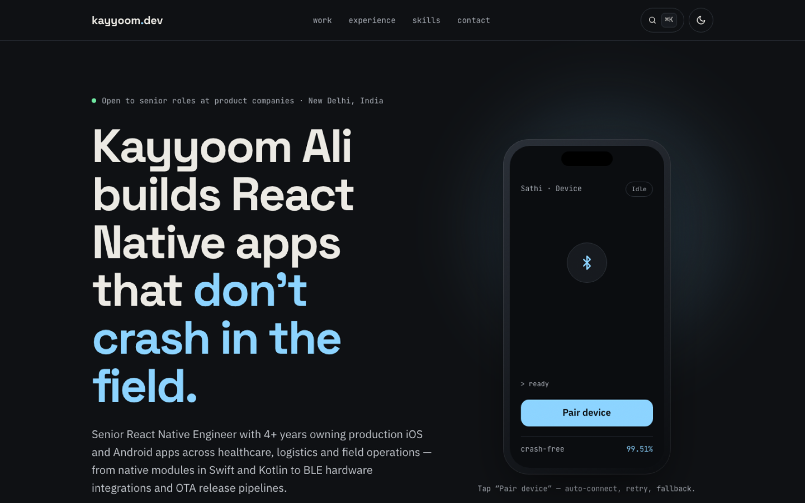
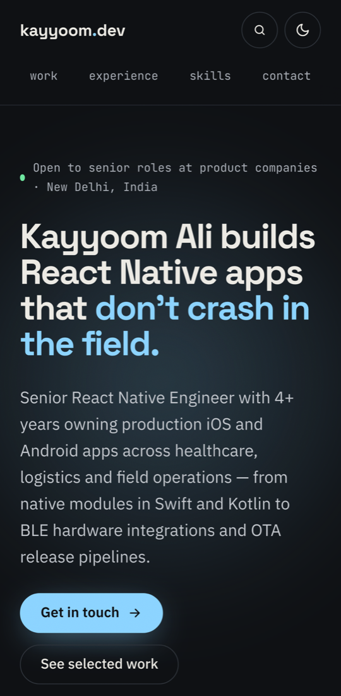

<div align="center">

# kayyoom.dev

**Portfolio of Kayyoom Ali — Senior React Native Engineer**
Production iOS & Android apps across healthcare, logistics and field operations.

[](https://kayyoomali.netlify.app)
[](https://www.linkedin.com/in/kayyoom-ali-bb989319b/)
[](mailto:kayyoomali17@gmail.com)


<br>


&nbsp;


</div>

---

## About

A fast, single-page portfolio built with **plain HTML, CSS and JavaScript**: no framework, no build step, nothing to install. The whole site is under 70 KB of code and costs nothing to host.

| | |
|---|---|
| **99.51%** | Sustained crash-free rate across field-operation apps |
| **~70%** | Faster feature release cycles via an OTA pipeline |
| **90%** | Reduction in BLE device pairing time |
| **5** | Production apps shipped on iOS and Android |

## Features

- **Interactive BLE demo:** a 3D phone mockup that tilts with the cursor. Tap *Pair device* to watch a simulated Bluetooth flow: scan, timeout, auto-retry, connected.
- **Command palette:** press <kbd>⌘</kbd> <kbd>K</kbd> / <kbd>Ctrl</kbd> <kbd>K</kbd> to jump to sections, copy the email, open projects, or switch theme and accent colour.
- **Project gallery:** filter by *Field ops*, *Healthcare* or *Commerce*. Cards have a cursor-following spotlight, a details modal, and direct App Store / Google Play links.
- **Motion:** word-by-word headline reveal, scroll-triggered fade-ins, count-up metrics, a timeline that fills as you scroll, magnetic buttons and a custom cursor.
- **Light & dark themes** with 4 accent colours, remembered between visits.
- **Accessible:** semantic HTML, full keyboard navigation, visible focus states, 44 px touch targets, and all animation disabled when `prefers-reduced-motion` is set.
- **Responsive:** from 320 px phones up to wide desktops.

## Apps featured

| App | What it is | Platforms |
|---|---|---|
| **Samplify Sathi** | Field-force management for phlebotomy operations | [Android](https://play.google.com/store/apps/details?id=com.samplify.pheblo) · [iOS](https://apps.apple.com/in/app/samplify-phlebo/id6654902760) |
| **Samplify Sarthi** | Logistics & sample tracking with real-time sync | [Android](https://play.google.com/store/apps/details?id=com.samplify&hl=en-IN) · [iOS](https://apps.apple.com/in/app/sarthi-runner/id6566180771) |
| **LokBest** | Grocery commerce with OAuth onboarding & analytics | [Android](https://play.google.com/store/apps/details?id=com.lokbest&hl=en-IN) · [iOS](https://apps.apple.com/in/app/lokbest/id1571909931) |
| **Phelans Pharmacy** | Medicine delivery with a large-scale catalog | [Android](https://play.google.com/store/apps/details?id=com.phelans&hl=en-IN) |
| **Swagmee Salon** | At-home salon services with Razorpay payments | [Android](https://play.google.com/store/apps/details?id=com.swagmee&hl=en-IN) |

## Project structure

```
.
├── index.html     # Page markup and content
├── styles.css     # Design tokens, themes, layout and animation
├── script.js      # Interactions: palette, BLE demo, filters, modal, reveals
├── resume.pdf     # Downloadable résumé
└── docs/          # Screenshots used in this README
```

## Run locally

No install needed. Open `index.html` in a browser, or serve the folder:

```bash
git clone https://github.com/techAli17/My-porfolio.git
cd My-porfolio
npx serve .          # or: python3 -m http.server 8000
```

## Deploy

Hosted for free on **Netlify**. With this repo linked to the Netlify project (no build command, publish directory `/`), every push to `main` goes live automatically.

It also works as-is on GitHub Pages, Vercel or Cloudflare Pages.

## Customise

- **Content:** edit the text directly in `index.html`. Project details for the modal live in the `PROJECTS` object in `script.js`.
- **Colours:** change `--accent` and the other tokens at the top of `styles.css`.
- **Résumé:** replace `resume.pdf`.

---

<div align="center">

**Open to senior React Native roles at product companies · New Delhi, India**

[kayyoomali.netlify.app](https://kayyoomali.netlify.app) · [LinkedIn](https://www.linkedin.com/in/kayyoom-ali-bb989319b/) · [GitHub](https://github.com/techAli17) · [kayyoomali17@gmail.com](mailto:kayyoomali17@gmail.com)

</div>
